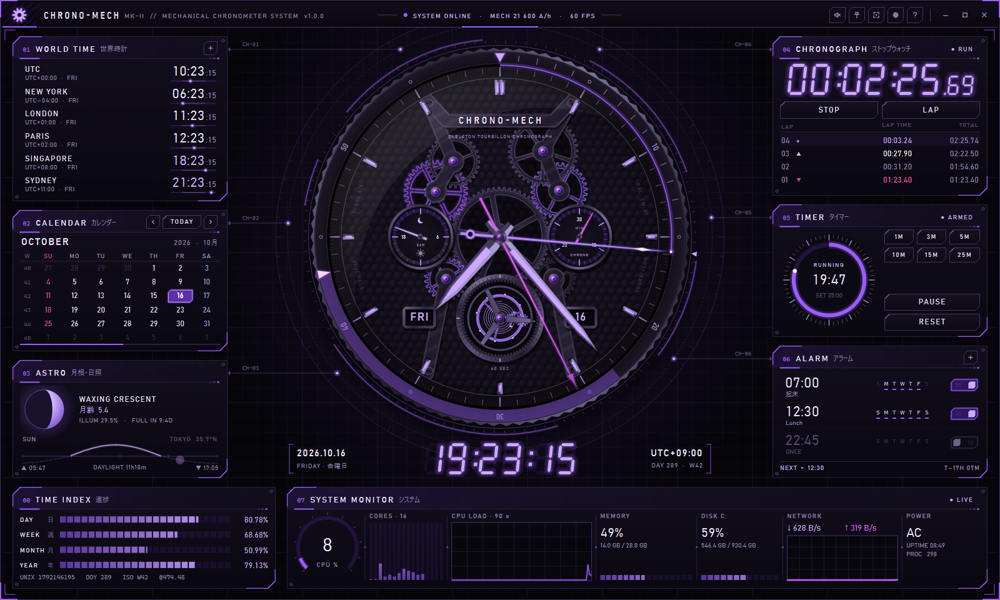
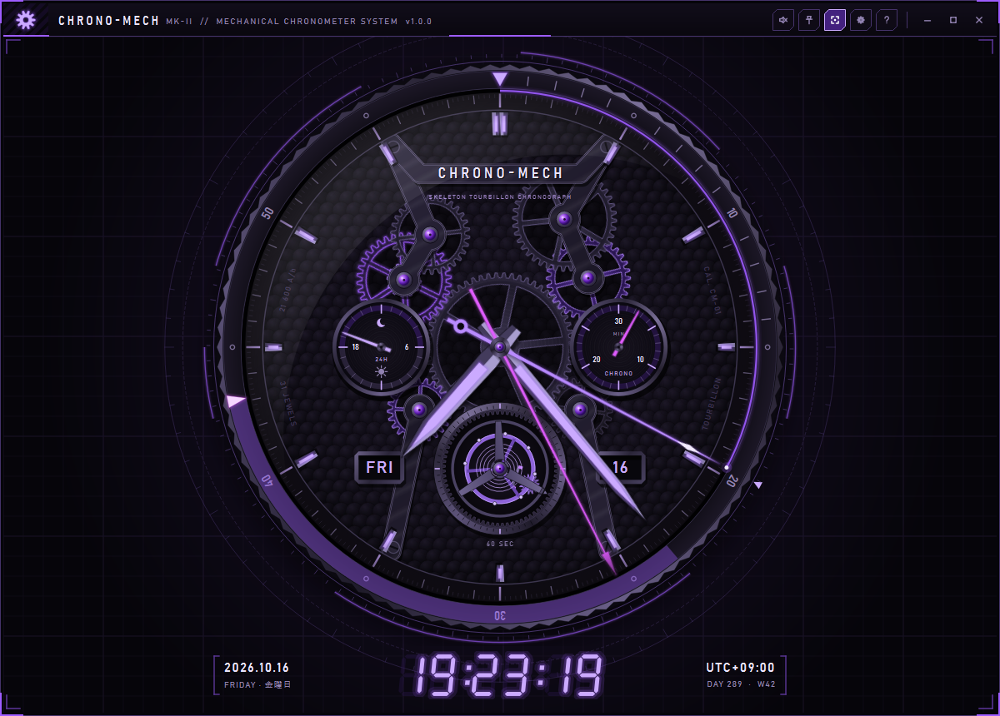

# CHRONO-MECH

黒 × 紫のメカニカルなデスクトップ時計。中央にスケルトン・トゥールビヨン・クロノグラフを据え、
その周囲に 8 つの機能モジュールを配置した HUD スタイルのアプリです（Python / PySide6）。



画像素材は一切使っていません。歯車・宝石・ブリッジ・針・アイコン・効果音まで、すべてコードで生成しています。

## 中央の時計

- **噛み合う輪列** — 歯車は歯数比どおりの速度で回り、歯と歯溝が正しく噛み合うように回転位相を計算しています
- **なめらかな運針** — 既定の SMOOTH では秒針・クロノグラフ針・輪列・トゥールビヨン・HUD リングが描画フレームごとに連続して動きます。設定で MECHANICAL（21,600 振動/時、毎秒 6 ステップで刻む機械式）や QUARTZ（1 秒ステップ）にも切り替えられます
- **トゥールビヨン** — 1 分で 1 回転するキャリッジ（矢印がスモールセコンドを兼用）。ガンギ車とアンクルはビートごとに作動
- **サブダイヤル** — 9 時位置に 24 時間計（昼夜表示）、3 時位置にクロノグラフ 30 分積算計
- **クロノグラフ針** — ストップウォッチを動かすとマゼンタの針が現れて連動
- **ダイバーズベゼル** — タイマー作動中は残り時間がベゼル上に帯で表示されます
- 曜日・日付窓、ペルラージュ仕上げの地板、コート・ド・ジュネーブのブリッジ、アメジストの軸受け宝石

`F` キーのフォーカスモードでは時計だけを大きく表示します。



## 機能モジュール

| # | モジュール | 内容 |
|---|---|---|
| 01 | WORLD TIME 世界時計 | 都市の追加（日本語名・IANA 名で検索可）、右クリックで並べ替え・削除、24 時間の昼夜バー |
| 02 | CALENDAR カレンダー | 日曜始まりの月表示、ISO 週番号、ホイールで月送り |
| 03 | ASTRO 月相・日照 | 月相と月齢（十三夜・十六夜などの和名つき）、観測地の日の出・日の入り、太陽の 24 時間軌跡 |
| 04 | CHRONOGRAPH ストップウォッチ | ラップ計測、ベスト ▲ / ワースト ▼ 表示、時計のクロノ針と連動 |
| 05 | TIMER タイマー | プリセット（25 分 = ポモドーロ）、ダイヤル上のホイールで ±1 分（Shift で ±10 秒）、ダブルクリックで時間入力 |
| 06 | ALARM アラーム | 曜日指定 / 1 回のみ、スヌーズ 5 分、ダブルクリックで編集 |
| 07 | SYSTEM MONITOR システム | CPU（全体・コア別・90 秒履歴）、メモリ、ディスク、ネットワーク、電源、稼働時間 |
| 08 | TIME INDEX 進捗 | 1 日・週・月・年の経過率、UNIX 時間、通算日、ISO 週、Swatch .beat |

そのほか: フレームレス HUD ウィンドウ（ドラッグ移動・端でリサイズ・ダブルクリックで最大化）、
フルスクリーン、常に手前に表示、秒の刻み音、起動アニメーション、設定とウィンドウ位置の自動保存。

## 必要環境

- Python 3.10 以上
- Windows 11 で開発・テスト。PySide6 が動く macOS / Linux でも動く想定です（未検証）
- フォントは Windows 標準の Bahnschrift を使用し、無い環境では Segoe UI などで代替します

## セットアップと起動

```powershell
python -m venv .venv
.venv\Scripts\activate          # macOS / Linux: source .venv/bin/activate
pip install -r requirements.txt
python main.py                  # または python -m chronomech
```

`pip install .` でインストールすると `chronomech` コマンドでも起動できます。

## 操作

| キー | 動作 |
|---|---|
| `Space` | クロノグラフ スタート / ストップ |
| `L` | ラップ |
| `R` | クロノグラフ リセット（停止中） |
| `T` | タイマー スタート / 一時停止 |
| `F` | フォーカスモード（時計のみ） |
| `F11` | フルスクリーン |
| `P` | 常に手前に表示 |
| `M` | 刻み音 オン / オフ |
| `Ctrl` + `,` | 設定 |
| `F1` | 操作一覧 |
| `Esc` | アラームを止める / フルスクリーン・フォーカス解除 |
| `Ctrl` + `Q` | 終了 |

アラーム・タイマーの通知中は `Enter` / `Esc` / `Space` で停止、`S` でスヌーズします。

## 設定

タイトルバーの歯車アイコン（`Ctrl` + `,`）から変更できます。

- **運針** — SMOOTH（既定・フレームごとに連続）/ MECHANICAL（毎秒 6 ステップ）/ QUARTZ（1 秒ステップ）
- **フレームレート** — 30 / 60 FPS
- **表示形式** — 24 時間 / 12 時間
- **サウンド** — 刻み音、音量
- **観測地** — 日の出・日の入りの計算地点（都市リストから選択、または緯度経度を入力）

設定ファイルの保存先:

- Windows: `%APPDATA%\ChronoMech\settings.json`
- macOS: `~/Library/Application Support/ChronoMech/settings.json`
- Linux: `~/.config/ChronoMech/settings.json`

## パフォーマンス

常駐させても負荷が小さくなるよう、描画をレイヤーに分けています。

- 静的な部品（地板・ブリッジ・文字盤・ベゼル）はサイズ変更時にだけ再生成
- 時針・分針・サブダイヤルなど動きの遅い部品は、1 秒に 1 回だけまとめて描き直す
- 毎フレーム、前回の描画から動いた部分（秒針の通り道、輪列、トゥールビヨン、HUD の弧の端）だけを再描画
- 時計ウィジェットは背景を自分で描く不透明ウィジェットにして、背面のウィンドウまで再描画が波及しないようにする
- 7 セグメント表示の文字はグロー込みでキャッシュ
- `psutil` によるシステム情報の取得はワーカースレッドで実行

開発環境（1920×1080、ウィンドウ 1500×940）での計測では、CPU 1 コアに対して
SMOOTH・60 FPS で約 22%、30 FPS で約 17%、MECHANICAL・60 FPS で約 18% です（目安。ストップウォッチ作動中は増えます）。
負荷を下げたい場合は 30 FPS を選んでください。ウィンドウを最小化している間は描画を止め、アラームとタイマーの監視だけを続けます。

## 構成

```
chronomech/
├── app.py              起動処理、アプリアイコン
├── theme.py            カラートークン、フォント、スタイルシート、描画ヘルパー
├── core/               UI に依存しないロジック
│   ├── engine.py       全体のハートビート（フレーム / 秒 / 分 / 日のシグナル）
│   ├── chrono.py       ストップウォッチ
│   ├── countdown.py    タイマー
│   ├── alarms.py       アラーム、スヌーズ
│   ├── astro.py        月相（Meeus）、日の出・日の入り（NOAA）
│   ├── cities.py       都市カタログ
│   ├── settings.py     設定の保存
│   └── sound.py        効果音の合成
└── ui/
    ├── clock.py        中央の機械式時計
    ├── mechanics.py    歯車・ブリッジ・宝石などの部品生成
    ├── widgets.py      パネル枠、ボタン、トグル、7 セグメント表示
    ├── main_window.py  レイアウト、ショートカット、各部の接続
    ├── titlebar.py / digital.py / overlay.py / dialogs.py
    └── panels/         各機能モジュール
```

## テスト

```powershell
python -m unittest discover -s tests
```

輪列の噛み合い、アラームのスケジュール、タイマー、ストップウォッチ、月相・日の出計算、設定の読み書きをテストしています。
